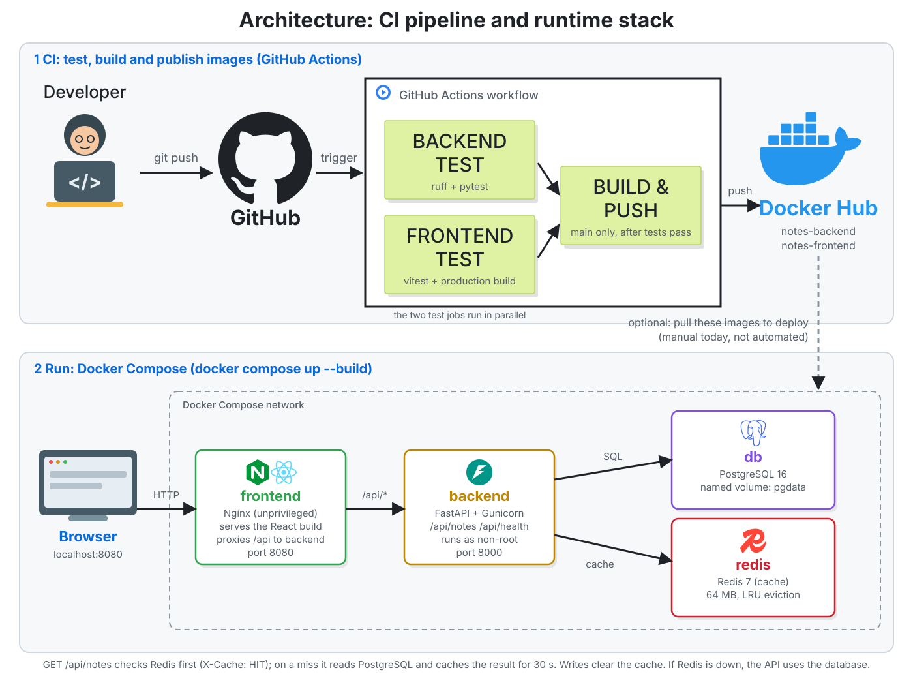
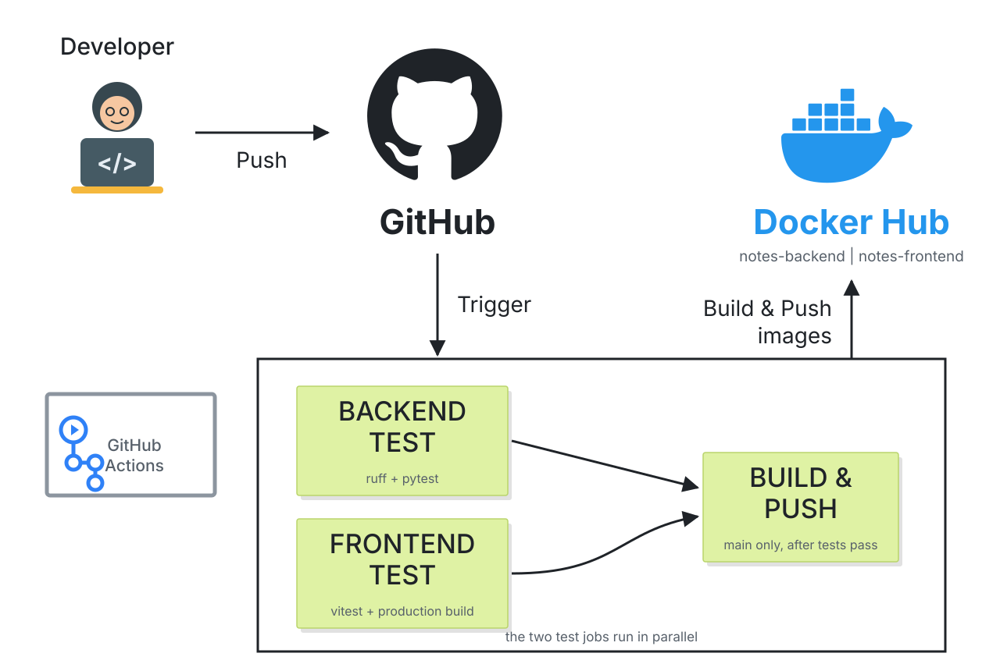

# Dockerized Multi-Stage Web Application

A small full-stack app (React + FastAPI + PostgreSQL + Redis behind Nginx) used to show how to
containerize an application properly: **multi-stage Dockerfiles** that keep images small,
**Docker Compose** that orchestrates four services with health checks, and a **GitHub Actions**
pipeline that tests the backend and frontend in parallel and then builds and pushes images to
Docker Hub.

It is a personal portfolio project. The application is deliberately simple (a notes app) so the
focus stays on the container, orchestration and CI/CD work around it.

## Architecture



| Service | Image | Role |
|---|---|---|
| `frontend` | Multi-stage: Node builds the React app, **unprivileged Nginx** serves it | Static files and a reverse proxy for `/api` |
| `backend` | Multi-stage: wheels built in one stage, **slim Python** runtime, non-root | FastAPI REST API served by Gunicorn |
| `db` | `postgres:16-alpine` | Stores notes, named volume `pgdata` |
| `redis` | `redis:7-alpine` | Caches the notes list (64 MB, LRU eviction) |

## How it works

**A request.** The browser talks only to Nginx on port 8080. Nginx serves the React build for
normal pages and forwards `/api/*` to the backend over the Compose network (service name
`backend`). The backend is never exposed to the host directly.

**Caching.** `GET /api/notes` checks Redis first. A hit returns the stored JSON with the header
`X-Cache: HIT` (the UI shows a badge). On a miss the API reads PostgreSQL, stores the result in
Redis with a 30-second TTL and returns `X-Cache: MISS`. Creating or deleting a note writes to
PostgreSQL and then deletes the cached list, so readers never see stale data after a write.
If Redis is unavailable the API logs a warning and falls back to the database: the app keeps
working and `/api/health` reports `"cache": "down"`.

**Startup order.** Compose starts PostgreSQL and Redis first and waits for their health checks.
The backend container then runs `python -m app.init_db` **once** to create the tables and only
then starts Gunicorn with two workers. (Creating tables inside each worker caused a startup race:
both workers ran `CREATE TABLE` at the same moment and one crashed with a unique violation. This
was found while testing the stack and fixed with the separate init step.) The frontend starts
after the backend reports healthy.

**Multi-stage builds.**

- *Frontend:* stage 1 uses a Node image to run `npm ci` and `npm run build`. Stage 2 starts from a
  small Nginx image and copies in only the built files. Node, `node_modules` and the sources
  never reach the final image.
- *Backend:* stage 1 builds the Python wheels. Stage 2 starts from a slim Python image,
  installs from those wheels with no network and no pip cache, and runs as a non-root user.

## CI/CD pipeline



The workflow in [`.github/workflows/ci.yml`](.github/workflows/ci.yml) runs on every push and pull request:

1. **backend-test:** `ruff` lint and format check, then `pytest`.
2. **frontend-test:** `npm ci`, `vitest`, then a production build.
3. **build-push:** runs only on pushes to `main`, and only if both test jobs passed. It builds both
   images with Buildx (using the GitHub Actions layer cache) and pushes them to Docker Hub as
   `notes-backend` and `notes-frontend`, tagged `latest` and with the commit SHA.

To enable the push step, add two repository secrets under *Settings, Secrets and variables, Actions*:
`DOCKERHUB_USERNAME` and `DOCKERHUB_TOKEN` (a Docker Hub access token, not your password).
Pull requests run the tests but never push images.

## Measured results

Each service was built twice: the usual single-stage way (full base image, build tools left in,
runs as root) and the multi-stage way used in this repository. These numbers come from
`scripts/measure-images.sh`, run on one machine, so treat the times as relative.

**Image size**

| Image | Single-stage | Multi-stage | Smaller by |
|---|---|---|---|
| Backend (Python) | 469 MB | 93 MB | 80% |
| Frontend (React) | 476 MB | 26 MB | 95% |

**Build time**

| Image | Cold build (no cache) | Rebuild after a source change |
|---|---|---|
| Backend, single-stage | 27.2 s | 1.0 s |
| Backend, multi-stage | 19.3 s | 1.8 s |
| Frontend, single-stage | 12.9 s | 1.0 s |
| Frontend, multi-stage | 10.4 s | 1.6 s |

Where the savings come from: the frontend image no longer contains Node, `node_modules` or the
sources, only the built files and Nginx. The backend saving mostly comes from the slim base image.
The multi-stage rebuild after a one-file change is about a second slower because of the extra
stage and copy steps, which is a small cost for images that are many times smaller. The full
report is in [docs/image-comparison.md](docs/image-comparison.md).

## Run it locally

Requirements: Docker with the Compose plugin.

```bash
cp .env.example .env          # optional: change the passwords
docker compose up -d --build
```

Open http://localhost:8080. API docs are at http://localhost:8080/api/docs.

```bash
docker compose ps                 # all four services should be healthy
curl localhost:8080/api/health    # {"status":"ok","database":"up","cache":"up"}
docker compose down -v            # stop and delete the database volume
```

### API

| Method | Path | Purpose |
|---|---|---|
| GET | `/api/notes` | List notes, newest first (cached, see `X-Cache`) |
| POST | `/api/notes` | Create `{"title": "...", "content": "..."}` |
| DELETE | `/api/notes/{id}` | Delete a note |
| GET | `/api/health` | Database and cache status |

## Tests

```bash
# backend: 13 tests (API, cache hit/miss/invalidation, Redis-down fallback, validation, init step)
cd backend && pip install -r requirements-dev.txt && python -m pytest

# frontend: 4 tests (render, empty state, add a note, backend unreachable)
cd frontend && npm ci && npm test
```

The backend tests use SQLite and an in-memory fake Redis, so they need no running services.
Beyond the unit tests, the full stack was started from an empty database three times in a row and
exercised through Nginx: health, create and list, cache MISS then HIT, invalidation on write,
input validation, single-page-app fallback, data surviving a backend restart, and the API staying
available with Redis stopped.

## Project structure

```
.
├── backend/
│   ├── app/                 FastAPI app (main, cache, db, schemas, init_db, config)
│   ├── tests/
│   ├── Dockerfile           multi-stage, non-root, health check
│   └── Dockerfile.single-stage   baseline used only for the size comparison
├── frontend/
│   ├── src/                 React app and tests
│   ├── nginx.conf           static files, /api proxy, security headers
│   ├── Dockerfile           multi-stage (Node build, unprivileged Nginx runtime)
│   └── Dockerfile.single-stage   baseline used only for the size comparison
├── docker-compose.yml
├── scripts/measure-images.sh    builds both variants and prints the comparison report
├── docs/                    diagrams and the measured comparison
└── .github/workflows/ci.yml
```

## Design decisions

- **Nginx in front of the API.** One origin for the browser, no CORS configuration, and the backend
  stays on the internal network.
- **Unprivileged Nginx and a non-root backend user.** Neither container runs as root.
- **Health checks and `depends_on: condition: service_healthy`.** Services start in the right
  order instead of failing and restarting.
- **The cache can fail safely.** Redis is an optimization, not a dependency.
- **Credentials come from the environment.** `.env` is git-ignored; the Compose defaults are for
  local development only.

## Known limitations

- Tables are created with `create_all` in a one-time init step. A real project would use
  migrations (for example Alembic).
- No authentication. Anyone who can reach the app can read and delete notes.
- Compose credentials are development defaults. Production would use a secret manager.
- Tested with Docker only. The Compose file uses standard features and should work with
  `podman compose`, but that has not been tested here.
- The backend and frontend test jobs pass on GitHub Actions. The image push job needs the two
  Docker Hub secrets described above before it can succeed.
- Images are not scanned for vulnerabilities in CI yet. Adding a Trivy step is a natural next step.
